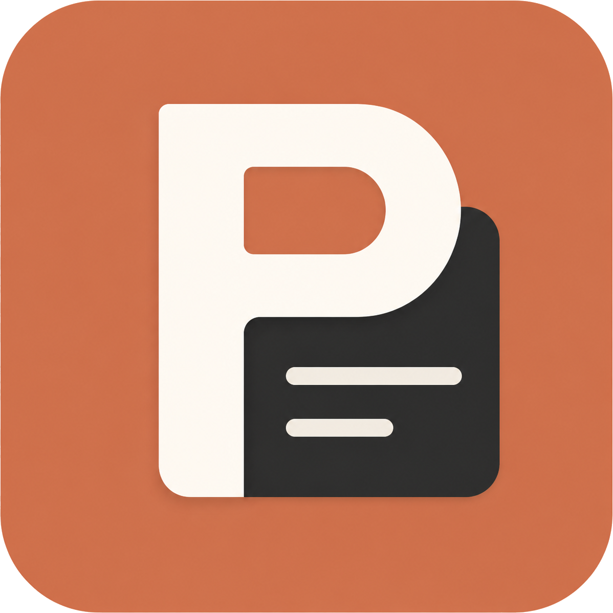

# Prompt Dock

**把好用的 Prompt 留下来，需要时，随手取用。**

一个本地优先的 Prompt 管理与快捷调用工具。 
文字、变体、参考图片和常用关键词，在一个桌面空间里整理。

[下载 Windows 版](https://github.com/Kesister/prompt-dock/releases/latest) · [下载 Mac 版](https://github.com/Kesister/prompt-dock/releases/tag/mac-v0.11.2) · [在线教程](https://kesister.github.io/prompt-dock/) · [视频演示](#演示) · [快速开始](#快速开始) · [使用指南](docs/USER-GUIDE.md) · [反馈问题](https://github.com/Kesister/prompt-dock/issues)

---

不想每次都翻聊天记录、找旧文档，再复制同一段提示词？把它收进 Prompt Dock：加上标签和使用说明，保留不同版本与参考图片；下次搜索、预览，再复制或插入到输入框。

无需注册账户，也无需配置 AI API。Prompt Dock **不是 AI 聊天客户端**，不会替你调用模型；它负责让你自己的内容更容易找到、复用。

> **使用教程：** [点击查看完整教程](https://kesister.github.io/prompt-dock/)，包含操作演示、快捷键和常见问题。

## 演示

https://github.com/user-attachments/assets/b3273881-3a8d-404b-804e-53ecfa3514eb

约 1 分钟，看看 Prompt 整理、快捷调用与词库的使用方式。演示中的内容仅作示例，不代表安装包附带完整素材库。

## 下载与安装

**普通用户请前往 [Releases 下载 Windows 安装包](https://github.com/Kesister/prompt-dock/releases/latest)，选择 `Prompt-Dock-版本号-Setup.exe`。**

Mac 用户请前往 [Mac 下载页](https://github.com/Kesister/prompt-dock/releases/tag/mac-v0.11.2)，下载 `.pkg` 安装包。支持 M 系列芯片、macOS 12 及以上版本。安装和权限设置见 [Mac 使用说明](docs/MAC-USER-GUIDE.md)。

| 平台 | 当前状态 |
| --- | --- |
| Windows x64 | v0.11.3 安装版，提供安装向导、桌面快捷方式和内置更新 |
| macOS Apple Silicon | v0.11.2 预览版，提供完整安装包；支持 macOS 12+，需手动下载更新 |
| Linux | 暂未提供发行包 |

Windows 与 Mac 共用源码，按平台独立发布修复版本；两端版本号可能不同。

- `Source code (zip / tar.gz)` 是源码，**不是安装程序**；Notion Skill 的 ZIP 也不是软件安装包。
- **Windows 更新：** v0.11.1 起可在设置中检查更新、下载新版并重启安装；安装前会自动备份资料。旧版用户首次升级仍需下载新安装包覆盖安装。[详细步骤](docs/USER-GUIDE.md#更新软件)
- 当前 Windows 安装包未做代码签名；Mac 安装包尚未完成 Apple 开发者签名与公证，系统可能提示来源限制。请确认下载自本仓库，按需使用附件中的校验文件核对下载内容。

## 快速开始

1. **存下第一条 Prompt：**
   点击「新建 Prompt」，填写标题和正文。按需添加标签、使用说明、图片与变体；使用说明不会混入复制的正文。
2. **找到并复用：**
   按 `Ctrl + K` 搜索，例如输入 `人物 模特 线稿`，可跨标题、说明、正文、标签和变体匹配。先预览，再复制或直接粘贴。
3. **在输入框里快捷调用：**
   在设置中开启「快捷调用」，先点进目标输入框，再按默认 `Ctrl + Alt + Space`。在浮窗内搜索、选择版本，按 `Tab` 确认；也可在设置中改为 `Enter`。无法可靠定位输入框时会退回仅复制，手动粘贴即可。

> 「唤出主窗口」与「快捷调用浮窗」是两套独立快捷键。当前版本不支持输入 `/` 或 `//` 触发。

Mac 对应快捷键：主窗口 `⌘⌥P`，搜索 `⌘K`，新建 `⌘N`，快捷调用 `⌘⇧Space`（需先在设置开启），`Tab` 确认。

## 核心功能

| 你想做的事 | Prompt Dock 的方式 |
| --- | --- |
| 把一条 Prompt 整理完整 | 正文、独立使用说明、自定义默认版本名和多个变体 |
| 快速找回内容 | 多关键词搜索、收藏、最近使用、使用次数排序 |
| 把库整理得有条理 | `父标签/子标签`、折叠分组、重命名、合并、批量管理、无标签入口 |
| 记住图片对应的效果 | 每条最多 6 张图片，支持粘贴、拖入、排序、封面、大图缩放与切换 |
| 少重复输入 | 全局快捷调用、候选预览、版本选择；或使用置顶与超小窗口 |
| 组合短词与关键词 | 独立词库、批量添加与去重、分类、收藏、批量移动和删除、组合复制 |
| 更安心地整理资料 | Prompt 回收站、完整导入导出、冲突处理、可选自动备份 |
| 分享界面而不露出正文 | 截图隐私模式，可遮挡 Prompt 内容及图片；它不是加密或访问锁 |

词库中的词条单击只会**复制到剪贴板**，由你手动粘贴；组合模式可以把多个词条连接后一次复制。

## 常用快捷键

| 操作 | 默认快捷键 | 生效位置 |
| --- | --- | --- |
| 唤出主窗口 | `Ctrl + Alt + P` | 全局，可修改 |
| 打开快捷调用浮窗 | `Ctrl + Alt + Space` | 全局，需先开启，可修改 |
| 聚焦搜索 | `Ctrl + K` | Prompt Dock 内 |
| 新建 Prompt | `Ctrl + N` | Prompt Dock 内，可修改 |
| 选择候选 / 进入变体 / 返回 | `↑ ↓` / `→` / `←` | 快捷调用浮窗内 |
| 确认 / 取消 | `Tab`（可改为 `Enter`）/ `Esc` | 快捷调用浮窗内 |

直接粘贴受目标软件、输入控件和权限影响，不能保证每个应用都支持。遇到兼容模式，复制后手动 `Ctrl + V` 是可靠的备用方式。[查看排查方法](docs/USER-GUIDE.md#快捷调用与直接粘贴)

## 数据与备份

你的库保存在本机：文字等元数据使用 SQLite，图片独立存储并去重。安装包不含作者的个人库；首次使用只有通用示例。

- **换电脑：** 在旧电脑导出 `.promptdock`，再在新电脑导入，文字、图片和词库一起带走。不要只复制程序 EXE。
- **自动备份：** 先在设置中选择备份目录。每天首次修改资料库时生成当天快照，**不是每次修改都备份，也不是持续更新的实时副本**。
- **保留规则：** 生成自动备份时，清理超过最近 3 个自然日的自动备份；不保证始终恰好 3 个文件。手动导出的备份不参与自动清理。
- **卸载：** 普通卸载默认保留本地库，但手动删除数据目录或使用清理工具仍可能丢失资料。重要内容请另存备份。
- **隐私边界：** 本地保存不等于加密。备份包含完整内容，请勿上传到公开 Issue 或此仓库；应用内没有账户锁或端到端加密。

更多细节见 [使用指南 · 数据、备份与恢复](docs/USER-GUIDE.md#数据备份与恢复)。

## 可选扩展：同步到 Notion

配套的 [Prompt Dock → Notion Codex Skill](docs/NOTION-SKILL.md) 可将你提供的 `.promptdock` 备份单向增量同步到自己的 Notion 数据库，按 ID 去重并检查冲突。

它是**独立的可选工具**，不是软件内置云同步，不会后台自动上传，也不随安装包自动安装。

## 反馈与参与

- **Bug 或功能建议：** [GitHub Issues](https://github.com/Kesister/prompt-dock/issues)
- **不方便使用 GitHub：** [问题反馈表单](https://kersss.notion.site/5cc968f36d944b1ab59abe70202e5147?source=copy_link)
- **开发与贡献：** [开发指南](docs/DEVELOPMENT.md) · [贡献说明](CONTRIBUTING.md) · [更新记录](docs/CHANGELOG.md)

反馈时请附上软件版本、操作系统版本、复现步骤和预期结果；截图前遮挡私人内容。可以在「关于与作者」中复制不含库内容的版本与环境信息。

由 [皮 / Kesister](https://github.com/Kesister) 持续打磨。少一点重复，多一点创造。

